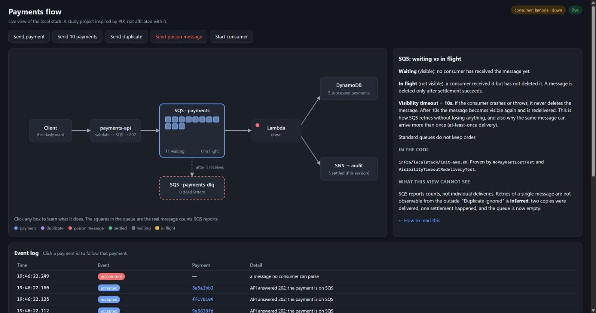
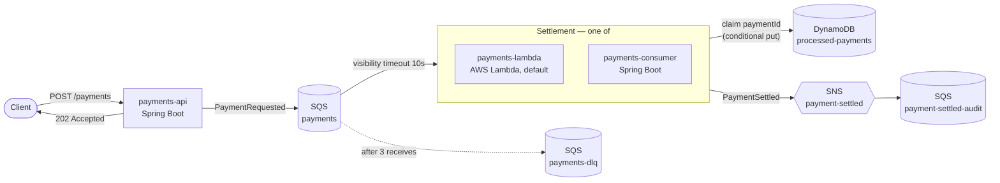

# aws-kafka-async-payments

[](https://github.com/natansalvadorligabo/aws-kafka-async-payments/actions/workflows/ci.yml)

Asynchronous payment intake inspired by Brazil's PIX: the API validates, queues and answers `202`, and a consumer settles each payment once.
A study project that compares SQS with Kafka and relational with non-relational storage, using tests that run fully locally (no AWS account).

> **Study project.** It is not affiliated with Banco Central do Brasil and does not implement the PIX protocol. "PIX" only inspires the domain: an account pays a key, and settlement happens out of band.

## Status

| Stage | Scope | State |
|---|---|---|
| 1. SQS | API → SQS → consumer, DLQ, visibility timeout, idempotency; consumer swapped for Lambda | ✅ done |
| 2. Kafka | same events on a topic, 3 consumer groups, key = account id, replay with a new group | ⏳ next |
| 3. Data | Postgres ledger (ACID); DynamoDB for idempotency, status and statement | ⏳ planned |

## Live dashboard

`make up` also starts a dashboard at **http://localhost:8081**. It draws the flow from the running stack: SQS's own message counters, settlements as SNS announces them, and dead letters as they reach the DLQ. Buttons provoke each scenario: stop the consumer, send payments, send a duplicate, send a poison message. Each box explains its concept and names the code and the test behind it.



What it cannot show: SQS reports counts, not individual deliveries, so the retries of a single message are invisible from outside. "Duplicate ignored" is *inferred*: two copies were delivered, one settlement happened, and the queue is empty.

## Architecture (stage 1)



- **The API acknowledges only after SQS accepts the message.** If no consumer is running, the payment waits on the queue.
- **A message is deleted only after settlement succeeds.** When settlement throws, the message reappears after the visibility timeout. After `maxReceiveCount = 3` receives, SQS moves it to the DLQ.
- **Idempotency.** SQS standard queues deliver *at least once*. Settlement first claims the `paymentId` with a DynamoDB conditional put (`attribute_not_exists`), so a second delivery becomes a no-op. If publishing fails after the claim, the claim is released so the redelivery can settle.
- **Two interchangeable consumers.** Both run the same framework-free `PaymentSettlement`. The Lambda reports failed records one by one (`ReportBatchItemFailures`), so one poison message does not send the whole batch back to the queue.

| Module | Role |
|---|---|
| `payments-contract` | `PaymentRequested`, `PaymentSettled` events |
| `payments-settlement` | settlement logic, DynamoDB idempotency, SNS notifier (no Spring) |
| `payments-api` | `POST /payments` → validate → SQS → `202` |
| `payments-consumer` | Spring Cloud AWS `@SqsListener` around `PaymentSettlement` |
| `payments-lambda` | `RequestHandler<SQSEvent, SQSBatchResponse>` around `PaymentSettlement` |
| `payments-dashboard` | live view of the stack (SSE + one static page, no build step) and scenario buttons |
| `payments-test-support` | the one LocalStack container all tests share, plus queue helpers |
| `infra/localstack` | `init-aws.sh` (queues, DLQ, topic, table) and `deploy-lambda.sh`, used by **both** compose and the tests |

## Quick start

Requirements: Docker, JDK 25, `make`. Everything else (Maven, LocalStack, AWS resources) comes with the repo.

```bash
make up                    # build, start LocalStack + API + dashboard, deploy the Lambda
                           # → open http://localhost:8081
make demo                  # consumer down → payments wait on SQS → consumer back → nothing lost → DLQ
make down

make up CONSUMER=spring    # same stack with the Spring Boot consumer instead of the Lambda
make demo CONSUMER=spring

make test                  # unit + integration tests (Testcontainers + LocalStack)
```

Send a payment by hand:

```bash
curl -i -X POST localhost:8080/payments -H 'Content-Type: application/json' \
  -d '{"accountId": "acc-1", "pixKey": "alice@example.com", "amount": 10.50}'
# HTTP/1.1 202
# {"paymentId":"…","status":"ACCEPTED"}
```

> LocalStack is pinned to `4.14.0`: from `2026.x` on, the image refuses to start without a `LOCALSTACK_AUTH_TOKEN`.

## What the tests prove

Each behaviour has an automated test against real SQS/SNS/DynamoDB/Lambda APIs (LocalStack). I also checked that the tests fail when the behaviour is removed: dropping the conditional put fails the idempotency test, and dropping the claim release fails the redelivery test.

| Behaviour | Spring consumer | Lambda |
|---|---|---|
| No loss: 20 payments sent while the consumer is down are all settled, exactly once, when it returns | `NoPaymentLostTest` | `SettlePaymentsLambdaIT` (event source mapping disabled → enabled) |
| A failed attempt reappears after the visibility timeout (gap ≥ the queue's `VisibilityTimeout`) and then settles | `VisibilityTimeoutRedeliveryTest` | — (same SQS mechanism) |
| A message that never settles ends up in the DLQ after 3 receives | `DeadLetterQueueTest` | `SettlePaymentsLambdaIT` |
| The same payment delivered twice is settled once | `IdempotentSettlementTest` | `SettlePaymentsLambdaIT` |
| Only the failing record of a batch is retried | — | `SettlePaymentsHandlerTest` |
| Invalid request → `400`, nothing queued; valid → `202` and on SQS | `PaymentControllerTest`, `PaymentQueueingTest` | |

## SQS vs Kafka

What stage 1 showed about SQS. The Kafka column will be filled in from what stage 2 shows.

| | SQS (observed) | Kafka |
|---|---|---|
| Delivery | at least once; duplicates must be handled by the consumer (`IdempotentSettlementTest`) | stage 2 |
| Retry | built in: an undeleted message comes back after the visibility timeout (≥ 10s here) | stage 2 |
| Poison messages | built-in DLQ via `RedrivePolicy` (`maxReceiveCount = 3`) | stage 2 |
| Consumer down | messages wait; nothing to configure (`NoPaymentLostTest`) | stage 2 |
| After consumption | the message is deleted, so there is no replay | stage 2 |
| Ordering | none on a standard queue | stage 2 |
| Serverless consumer | native Lambda trigger with per-record failure reporting | stage 2 |

## Postgres vs DynamoDB

Stage 3. So far DynamoDB is only used as the idempotency store: a single conditional put decides "first delivery or duplicate".

## Results

Measured on one local machine (Windows 11, Docker Desktop 29.6, LocalStack 4.14.0, JDK 25). The numbers depend on the machine.

| Measurement | Value |
|---|---|
| Full suite (`./mvnw verify`, 34 tests, 4 modules with LocalStack) | 262 s, all green |
| Message that never settles → DLQ (visibility timeout 10s × 3 receives), Spring consumer | 42.9 s (test duration) |
| Demo: 5 payments queued with the consumer down → settled after restart | 5 / 5, both consumers |
| Message that never settles → DLQ, Lambda consumer, seen on the dashboard | 52 s (sent 22:38:15, dead-lettered 22:39:07) |
| 10 payments sent with the Lambda trigger disabled for ~9 s, latency from `202` to settled | 12.5–12.7 s (time spent waiting on SQS) |
| Lambda deployment zip (handler + dependencies, `lib/` layout) | 21.5 MB |

## Repository layout

```
infra/localstack/      init-aws.sh, deploy-lambda.sh   (shared by compose and tests)
payments-*/            Maven modules (see table above)
scripts/demo.sh        the demo behind `make demo`
docs/                  images used by this README
.github/workflows/     CI: `make test`, plus `make up && make demo` for each consumer
```
